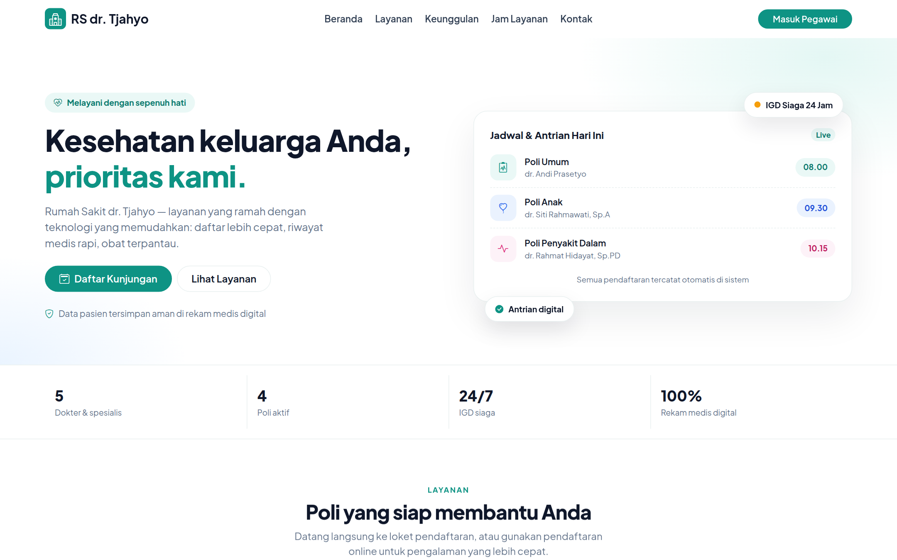
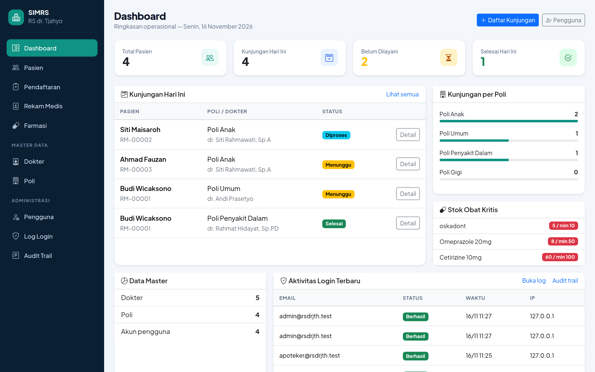
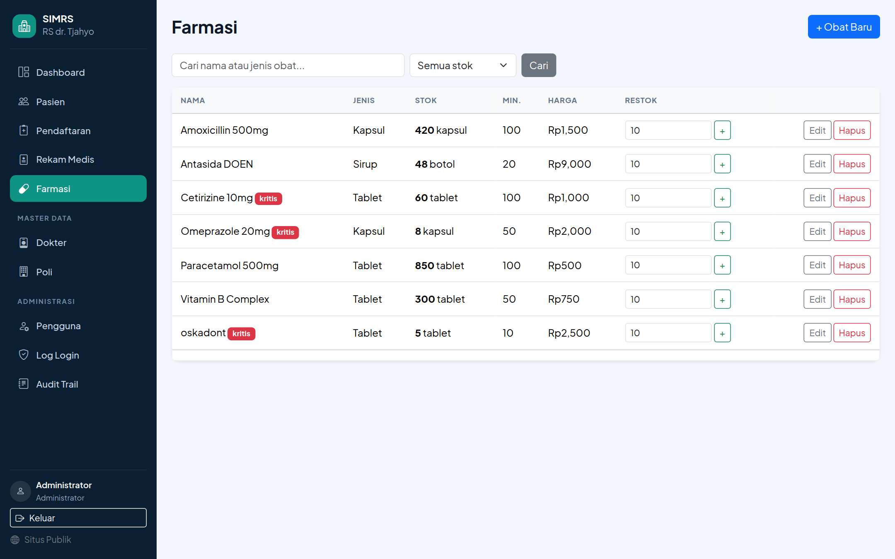
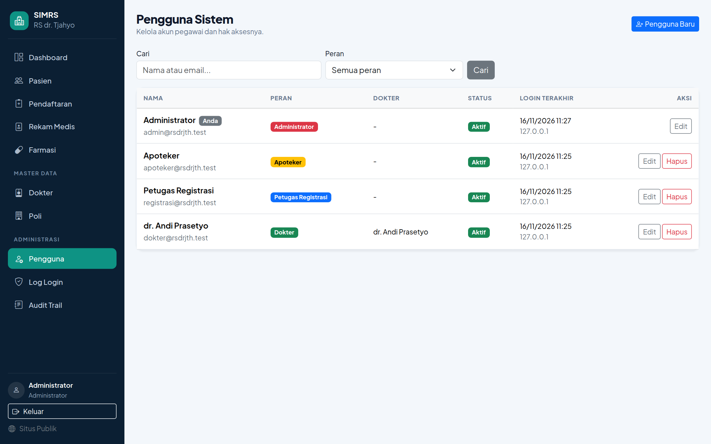
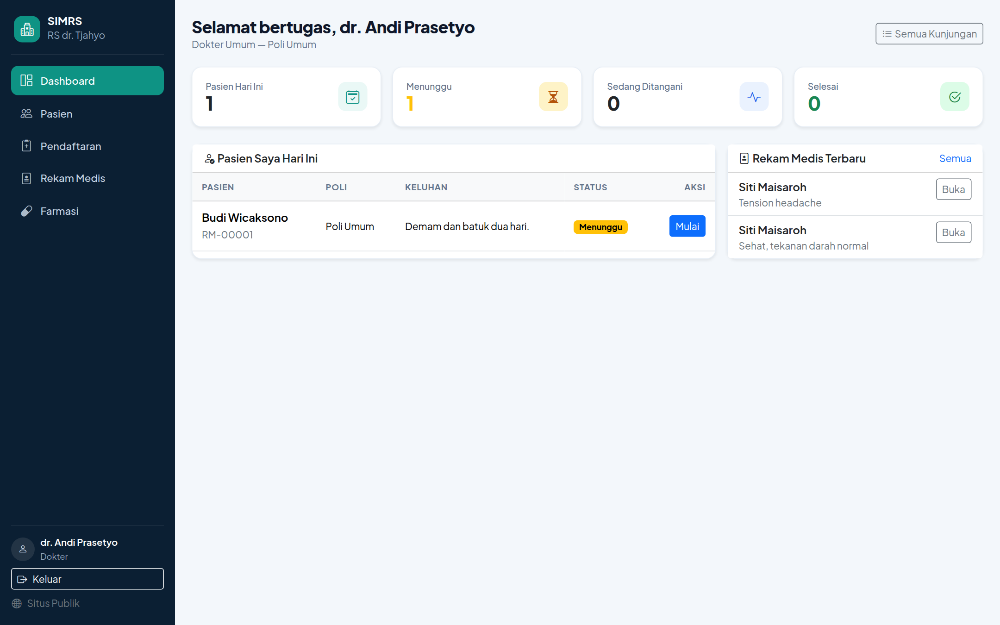
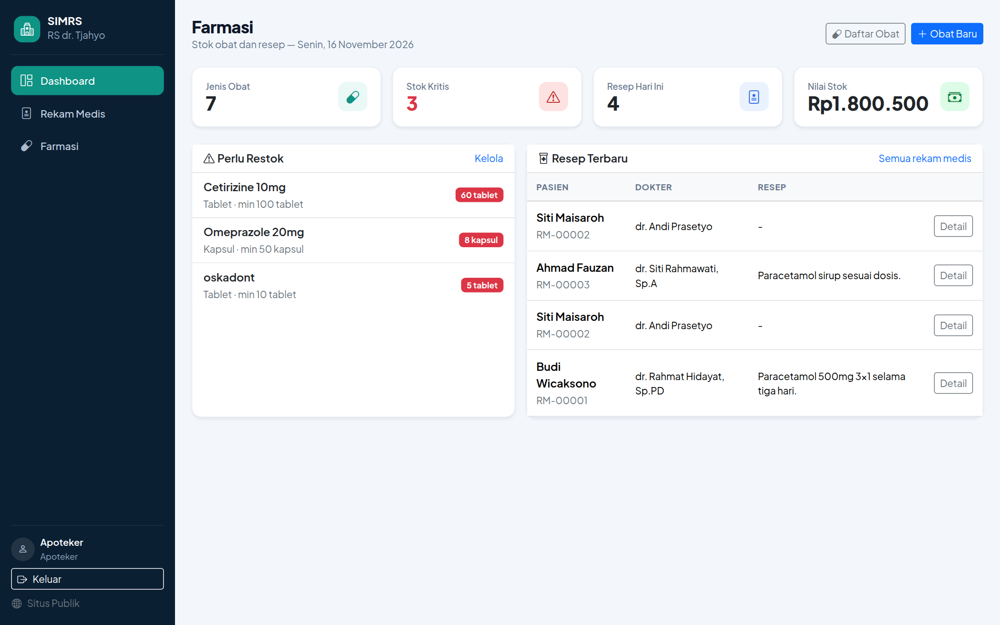
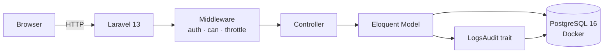
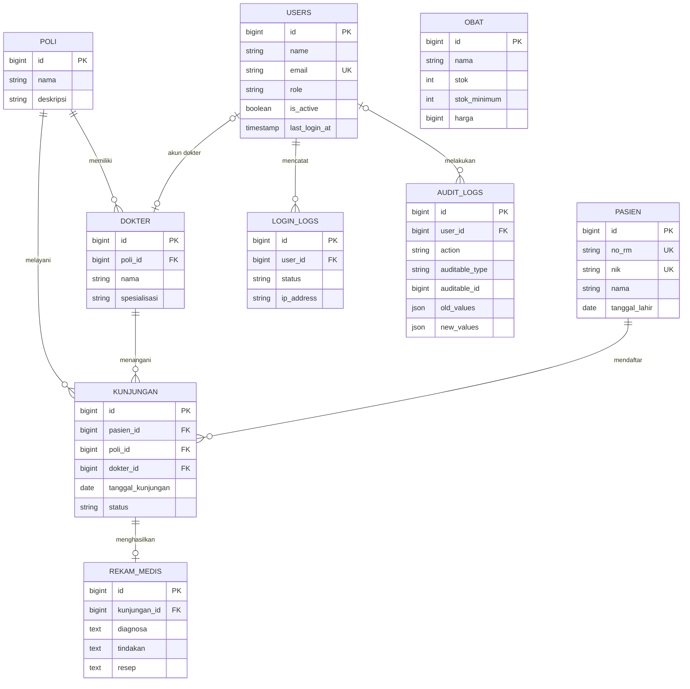

# SIMRS dr. Tjahyo

Sistem Informasi Manajemen Rumah Sakit (SIMRS) berbasis web untuk mengelola
pendaftaran pasien, kunjungan, rekam medis, dan stok obat — dengan hak akses
per peran dan **audit trail** untuk setiap perubahan data.




## Latar belakang

Rumah sakit kecil dan klinik sering masih mencatat pendaftaran pasien secara
manual atau memakai spreadsheet. Cara ini rawan: data mudah tertukar, stok obat
tidak diketahui, dan tidak ada catatan siapa yang mengubah data pasien.

Proyek ini membangun alur inti SIMRS sebagai aplikasi web:

1. Petugas registrasi mendaftarkan pasien dan membuat kunjungan.
2. Dokter memeriksa pasien dan mengisi rekam medis.
3. Apoteker memantau stok obat dan membaca resep.
4. Administrator mengelola akun, master data, dan memeriksa jejak perubahan.

Fokus proyek bukan sekadar CRUD, tetapi **keamanan akses** dan **ketertelusuran
data** — dua hal yang wajib ada di sistem kesehatan.

## Tangkapan layar

| Dashboard Administrator | Audit Trail |
|---|---|
|  |  |

| Farmasi & stok obat | Manajemen pengguna |
|---|---|
|  |  |

Satu akun, satu tampilan. Dashboard menyesuaikan peran pengguna:

| Registrasi | Dokter | Apoteker |
|---|---|---|
|  |  |  |

## Fitur

- **Halaman publik** profil rumah sakit: layanan, jadwal dokter, dan informasi IGD.
- **Login aman**: pembatasan 5 percobaan per 60 detik, akun nonaktif ditolak,
  dan setiap percobaan login dicatat.
- **RBAC (Role-Based Access Control)**: 4 peran dengan izin berbeda, ditegakkan
  di server — bukan hanya menyembunyikan menu.
- **Dashboard per peran** dengan ringkasan angka dan antrean kerja.
- **Manajemen pasien**: nomor rekam medis otomatis, pencarian, validasi NIK unik.
- **Kunjungan**: pendaftaran ke poli/dokter, perubahan status antrean.
- **Rekam medis**: diagnosa, tindakan, resep, dan catatan dokter.
- **Farmasi**: stok obat, penanda stok kritis, harga.
- **Manajemen pengguna**: aktif/nonaktif akun, penautan akun ke data dokter.
- **Audit trail**: siapa, kapan, data apa, nilai lama → nilai baru, dan alamat IP.
- **Log login**: riwayat berhasil/gagal beserta IP dan perangkat.

## Peran dan hak akses

| Modul | Admin | Registrasi | Dokter | Apoteker |
|---|:--:|:--:|:--:|:--:|
| Dashboard | ✅ | ✅ | ✅ | ✅ |
| Pasien (lihat) | ✅ | ✅ | ✅ | — |
| Pasien (kelola) | ✅ | ✅ | — | — |
| Kunjungan (lihat) | ✅ | ✅ | ✅ | — |
| Kunjungan (kelola) | ✅ | ✅ | — | — |
| Kunjungan (proses) | ✅ | ✅ | ✅ | — |
| Rekam medis (lihat) | ✅ | — | ✅ | ✅ |
| Rekam medis (kelola) | ✅ | — | ✅ | — |
| Obat (lihat) | ✅ | — | ✅ | ✅ |
| Obat (kelola) | ✅ | — | — | ✅ |
| Poli & dokter | ✅ | — | — | — |
| Pengguna | ✅ | — | — | — |
| Log login | ✅ | — | — | — |
| Audit trail | ✅ | — | — | — |

## Stack

| Bagian | Teknologi |
|---|---|
| Framework | Laravel 13 (PHP 8.3) |
| Database | PostgreSQL 16 (Docker) |
| Tampilan | Blade + Bootstrap 5 + Bootstrap Icons (CDN) |
| Autentikasi | Session Laravel, rate limiter, log login |
| Pengujian | PHPUnit (31 tes, 123 assertion) |
| Kode style | Laravel Pint |
| Zona waktu | `Asia/Jakarta` |

Tanpa build step frontend: tidak ada Node/Vite yang perlu dijalankan.

## Arsitektur



Alur satu permintaan:

1. **Middleware** memastikan pengguna sudah login, akunnya aktif, dan punya izin
   (`can:pasien.kelola`).
2. **Controller** memvalidasi input lalu memanggil model.
3. **Model** menyimpan perubahan; trait `LogsAudit` otomatis menulis satu baris
   ke `audit_logs`.
4. **Blade** merender halaman dengan menu yang sudah disaring sesuai izin.

## Struktur database



## Menjalankan di komputer sendiri

Prasyarat: PHP 8.3+, Composer, dan Docker.

```bash
# 1. Dependensi
composer install

# 2. Konfigurasi
cp .env.example .env
php artisan key:generate

# 3. Nyalakan PostgreSQL
docker compose up -d

# 4. Buat tabel + data demo
php artisan migrate:fresh --seed

# 5. Jalankan
php artisan serve
```

Buka <http://127.0.0.1:8000> untuk halaman publik, dan
<http://127.0.0.1:8000/login> untuk masuk sebagai pegawai.

> `npm run dev` **tidak diperlukan**. CSS/JS memakai CDN, bukan Vite.

## Akun demo

Semua akun memakai password `password` (khusus data demo).

| Email | Peran |
|---|---|
| `admin@rsdrjth.test` | Administrator |
| `registrasi@rsdrjth.test` | Petugas Registrasi |
| `dokter@rsdrjth.test` | Dokter |
| `apoteker@rsdrjth.test` | Apoteker |

## Pengujian

```bash
php artisan test
```

Hasil: **31 tes, 123 assertion**, mencakup:

- login berhasil/gagal, pembatasan percobaan, akun nonaktif;
- otorisasi tiap peran (termasuk akses yang harus ditolak);
- CRUD pasien dan pengguna beserta validasinya;
- audit trail: dibuat/diubah/dihapus, nilai lama vs baru;
- password tidak pernah tersimpan di audit trail;
- login tidak dianggap sebagai perubahan data pengguna.

Tes berjalan di SQLite in-memory sehingga tidak menyentuh database development.

## Keputusan teknis

**Audit trail memakai trait, bukan package.** Package audit biasanya menambah
dependensi dan konfigurasi yang sulit dikendalikan. Dengan trait `LogsAudit`,
setiap model cukup menambahkan `use LogsAudit` dan otomatis tercatat pada event
`created`, `updated`, dan `deleted`. Kolom sensitif dikecualikan di satu tempat.

**Nilai password tidak pernah disimpan.** Kolom `password` dikecualikan dari
audit. Yang tercatat hanya fakta bahwa akun diubah — bukan isi password.

**Perubahan dari console tidak dicatat.** Seeder dan `artisan tinker` sengaja
dilewati agar data demo tidak mengotori audit trail. Audit hanya merekam
perubahan yang benar-benar dilakukan pengguna lewat aplikasi.

**RBAC memakai Enum + Gate.** Peran dan izin didefinisikan sebagai Enum PHP,
sehingga salah ketik nama izin langsung menjadi error saat development, bukan
bug diam-diam di produksi. Pemeriksaan dilakukan di middleware `can:`, jadi
menyembunyikan tombol saja tidak cukup untuk menembus halaman.

**PostgreSQL, bukan SQLite.** PostgreSQL lebih dekat ke kondisi produksi:
mendukung `json` untuk audit trail, tipe data ketat, dan konkurensi banyak
pengguna. Docker dipakai agar versi database seragam di semua komputer.

**Pembatasan login.** `RateLimiter` membatasi 5 percobaan per 60 detik per
email + IP. Setiap percobaan dicatat di `login_logs` untuk mendeteksi
percobaan akses tidak sah.

## Struktur folder penting

```
app/
├── Enums/                  Role, Permission, StatusKunjungan
├── Http/Controllers/       Satu controller per modul
├── Http/Middleware/        Pemeriksaan akun aktif
├── Models/
│   └── Concerns/
│       └── LogsAudit.php   Pencatat audit trail
database/
├── migrations/             Skema tabel
├── seeders/                Data demo
└── factories/              Data palsu untuk tes
resources/views/
├── layouts/app.blade.php   Kerangka dashboard + sidebar
├── dashboard/              Satu view per peran
└── audit-log/              Penampil audit trail
tests/Feature/              Tes alur nyata lewat HTTP
```

## Batasan saat ini

Proyek ini adalah **prototipe yang berjalan**, belum sistem siap produksi:

- Belum ada modul kasir/billing, laboratorium, radiologi, dan rawat inap.
- Belum ada cetak PDF (resep, kuitansi, surat keterangan).
- Belum terintegrasi SATUSEHAT/HL7 FHIR.
- Belum ada 2FA dan idle timeout.
- Belum ada backup otomatis terjadwal.
- Data demo masih sedikit.

## Rencana pengembangan

- [ ] Modul kasir dan cetak kuitansi PDF
- [ ] Grafik kunjungan dan pendapatan di dashboard
- [ ] 2FA untuk administrator
- [ ] Backup otomatis harian + uji restore
- [ ] Dockerfile aplikasi agar `docker compose up` menjalankan semuanya
- [ ] CI GitHub Actions menjalankan tes di setiap push
- [ ] Integrasi SATUSEHAT

## Perintah yang sering dipakai

```bash
docker compose ps                 # status database
docker compose stop               # hentikan (data tetap aman)
docker compose up -d              # nyalakan lagi
php artisan migrate:fresh --seed  # reset database + data demo
php artisan test                  # jalankan tes
php artisan db:show               # info database
```

### Backup & restore

```bash
# Backup
docker exec simrs-postgres pg_dump -U simrs simrs > backup-$(date +%Y%m%d-%H%M).sql

# Restore
cat backup-20260101-1200.sql | docker exec -i simrs-postgres psql -U simrs -d simrs
```

## Catatan produksi

- Ganti seluruh password demo dan hapus akun demo.
- Ganti `php artisan serve` dengan **Nginx + PHP-FPM**.
- Aktifkan **HTTPS** dan batasi akses database dari jaringan luar.
- Jadwalkan backup otomatis dan **uji restore**-nya.
- Jangan pernah menyimpan `.env` atau file backup di Git.

---

Dibuat sebagai proyek portofolio fullstack: Laravel, PostgreSQL, RBAC,
audit trail, dan automated test.
