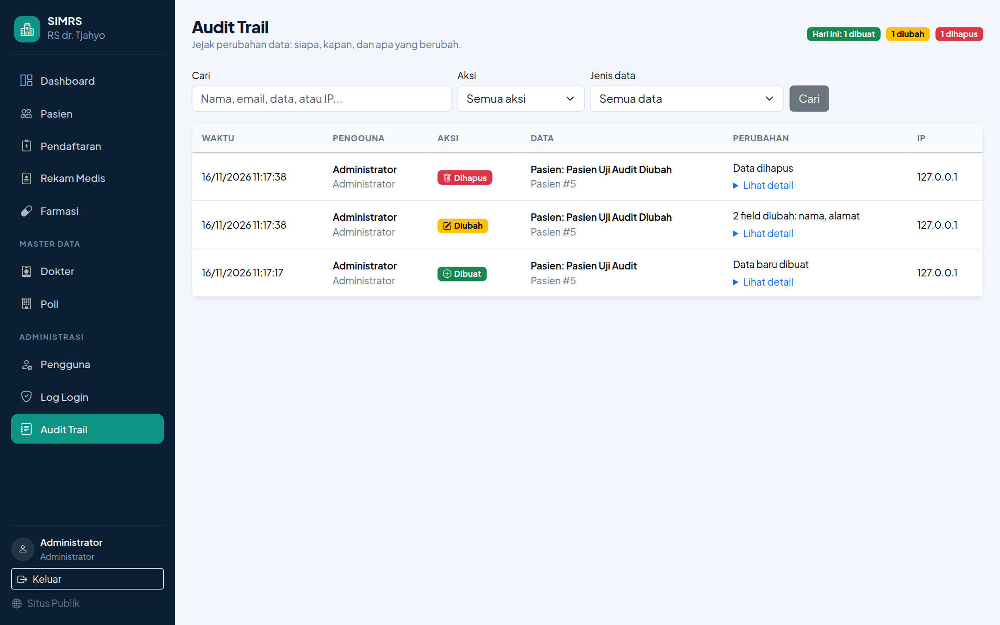
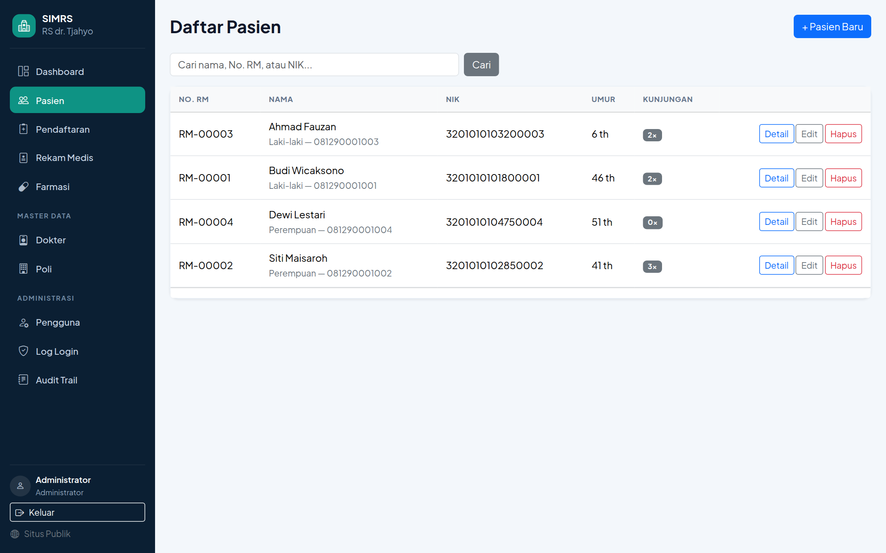
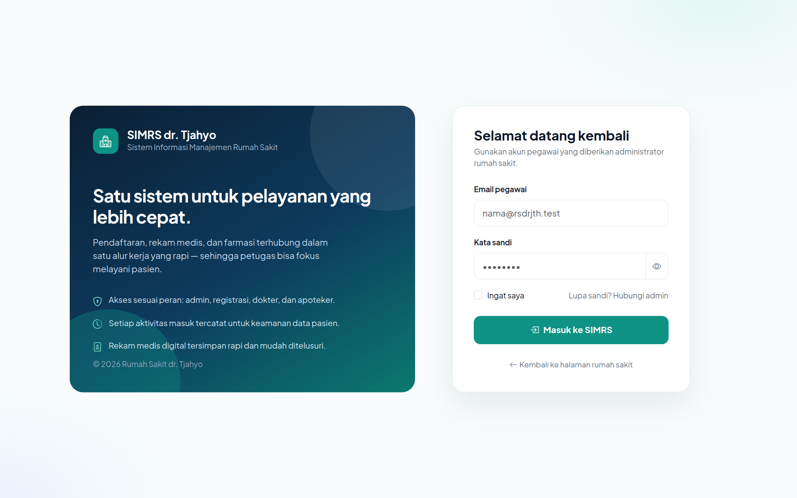
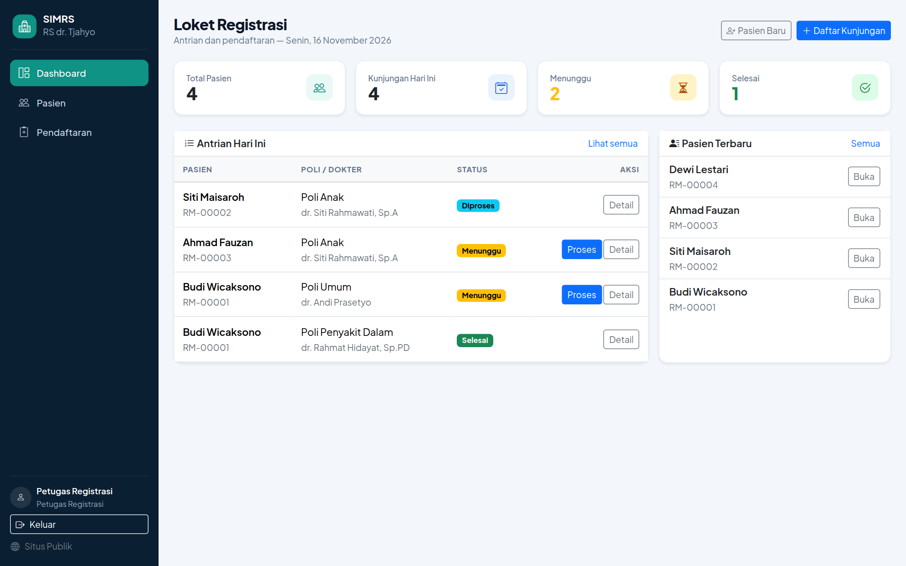
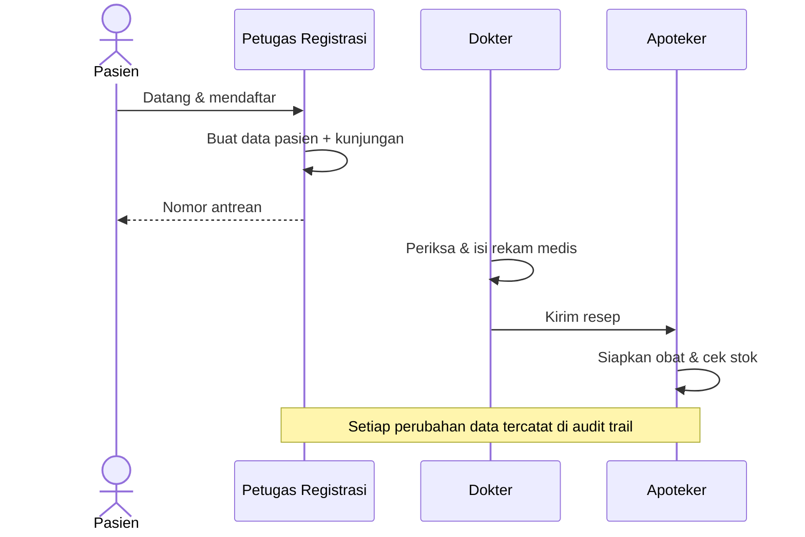
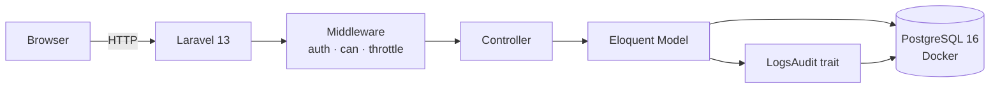
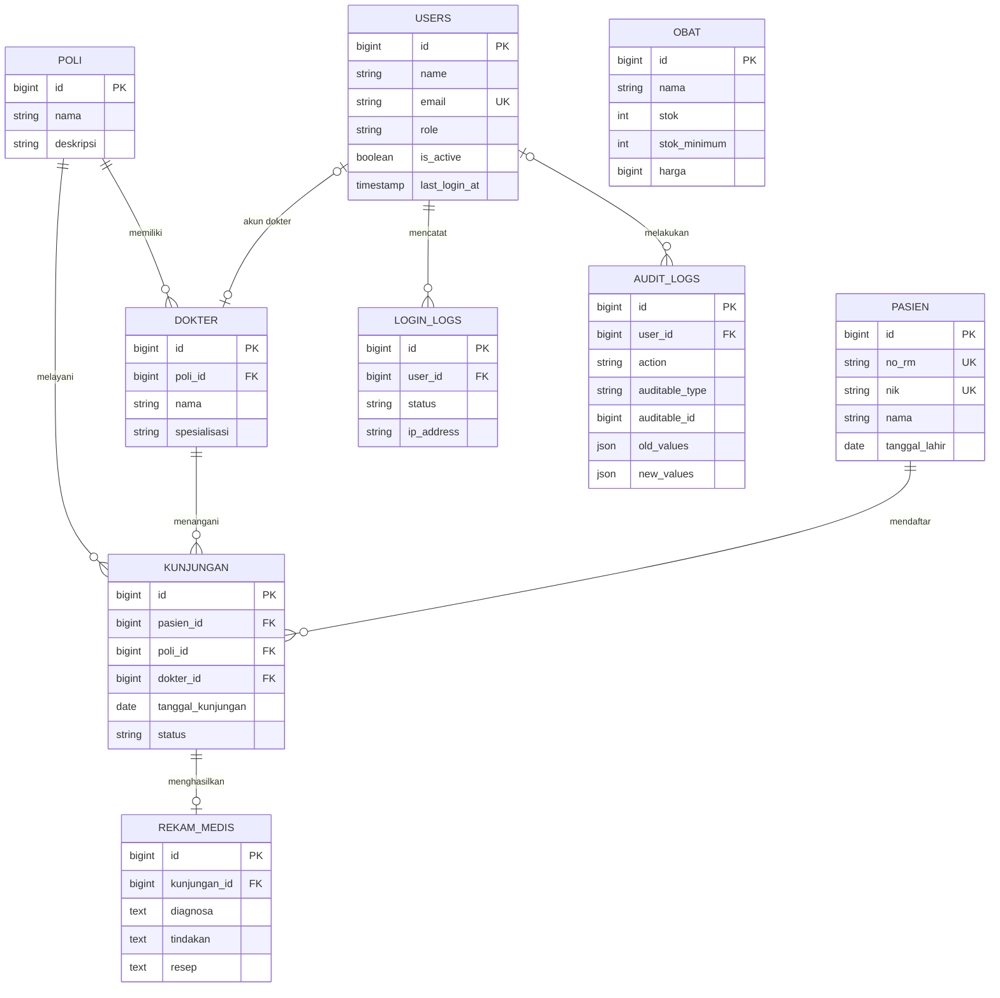

<div align="center">

# SIMRS dr. Tjahyo

**Sistem Informasi Manajemen Rumah Sakit berbasis web**

Pendaftaran · Kunjungan · Rekam Medis · Farmasi · Audit Trail


</div>

---

Rumah sakit kecil dan klinik sering masih mencatat pendaftaran pasien secara
manual atau memakai spreadsheet. Cara ini rawan: data mudah tertukar, stok obat
tidak diketahui, dan **tidak ada catatan siapa yang mengubah data pasien**.

Proyek ini membangun alur inti SIMRS sebagai aplikasi web — dengan dua hal yang
sering dilewatkan proyek latihan: **hak akses yang benar-benar ditegakkan di
server** dan **jejak audit untuk setiap perubahan data**.

> [!TIP]
> Ingin langsung mencoba? Jalankan 5 perintah di bagian [Mulai cepat](#mulai-cepat),
> lalu masuk dengan akun demo di bagian [Akun demo](#akun-demo).

📄 **Dokumentasi lengkap:** [Deskripsi sistem (Indonesia)](docs/deskripsi-sistem.md) ·
[System description (English)](docs/system-description.md)

<details>
<summary><b>Daftar isi</b></summary>

- [Sekilas](#sekilas)
- [Tangkapan layar](#tangkapan-layar)
- [Fitur](#fitur)
- [Peran dan hak akses](#peran-dan-hak-akses)
- [Alur penggunaan](#alur-penggunaan)
- [Stack](#stack)
- [Arsitektur](#arsitektur)
- [Struktur database](#struktur-database)
- [Mulai cepat](#mulai-cepat)
- [Akun demo](#akun-demo)
- [Pengujian](#pengujian)
- [Keamanan](#keamanan)
- [Keputusan teknis](#keputusan-teknis)
- [Struktur folder](#struktur-folder)
- [Batasan](#batasan)
- [Rencana pengembangan](#rencana-pengembangan)
- [Perintah harian](#perintah-harian)

</details>

## Sekilas

| Modul | Peran | Tabel | Automated test | Screenshot |
|:--:|:--:|:--:|:--:|:--:|
| **7** | **4** | **16** | **31** (123 assertion) | **10** |

**Yang membedakan proyek ini:**

- 🔐 **RBAC 4 peran** — izin diperiksa lewat middleware `can:` di server, bukan
  sekadar menyembunyikan menu. Ada tes yang memastikan akses terlarang benar-benar
  ditolak (403).
- 🧾 **Audit trail** — setiap create/update/delete mencatat siapa, kapan, dari IP
  mana, dan perubahan nilai **lama → baru**. Password tidak pernah ikut dicatat.
- 🧪 **31 tes otomatis** — alur login, otorisasi, CRUD, dan audit diuji lewat HTTP,
  bukan hanya unit test.
- 🎨 **Tampilan tanpa template** — landing page dan dashboard ditulis sendiri
  dengan Bootstrap 5, tanpa build step Node/Vite.

## Tangkapan layar

### Dashboard Administrator


### Audit Trail — inti nilai proyek ini

Setiap perubahan data bisa ditelusuri: siapa pelakunya, kapan, dan apa yang berubah.



### Modul operasional

| Farmasi & stok obat | Manajemen pengguna |
|---|---|
|  |  |

| Data pasien | Login pegawai |
|---|---|
|  |  |

### Satu akun, satu tampilan

Menu dan isi dashboard menyesuaikan peran pengguna.

| Registrasi | Dokter | Apoteker |
|---|---|---|
|  |  |  |

## Fitur

**Publik**

- Profil rumah sakit: layanan, jadwal dokter, dan informasi IGD 24 jam.
- Halaman responsif, tanpa dependensi build frontend.

**Autentikasi & keamanan**

- Login dengan pembatasan **5 percobaan per 60 detik** (per email + IP).
- Akun nonaktif langsung ditolak.
- Setiap percobaan login dicatat: berhasil/gagal, IP, dan perangkat.
- Sesi disimpan di database, ID sesi diperbarui setelah login.

**Operasional**

- **Pasien** — nomor rekam medis otomatis, NIK unik, pencarian cepat.
- **Kunjungan** — pendaftaran ke poli/dokter, alur status antrean.
- **Rekam medis** — diagnosa, tindakan, resep, catatan dokter.
- **Farmasi** — stok obat, penanda stok kritis, harga.
- **Pengguna** — aktif/nonaktif akun, penautan akun ke data dokter.
- **Audit trail** — filter per aksi, jenis data, pengguna, dan IP.
- **Log login** — riwayat akses beserta status.

## Peran dan hak akses

| Modul | Admin | Registrasi | Dokter | Apoteker |
|---|:--:|:--:|:--:|:--:|
| Dashboard | ✅ | ✅ | ✅ | ✅ |
| Pasien (lihat) | ✅ | ✅ | ✅ | — |
| Pasien (kelola) | ✅ | ✅ | — | — |
| Kunjungan (lihat) | ✅ | ✅ | ✅ | — |
| Kunjungan (kelola) | ✅ | ✅ | — | — |
| Kunjungan (proses) | ✅ | ✅ | ✅ | — |
| Rekam medis (lihat) | ✅ | — | ✅ | ✅ |
| Rekam medis (kelola) | ✅ | — | ✅ | — |
| Obat (lihat) | ✅ | — | ✅ | ✅ |
| Obat (kelola) | ✅ | — | — | ✅ |
| Poli & dokter | ✅ | — | — | — |
| Pengguna | ✅ | — | — | — |
| Log login | ✅ | — | — | — |
| Audit trail | ✅ | — | — | — |

## Alur penggunaan



## Stack

| Bagian | Teknologi |
|---|---|
| Framework | Laravel 13 (PHP 8.3) |
| Database | PostgreSQL 16 (Docker) |
| Tampilan | Blade + Bootstrap 5 + Bootstrap Icons (CDN) |
| Autentikasi | Session Laravel, rate limiter, log login |
| Pengujian | PHPUnit — 31 tes, 123 assertion |
| Gaya kode | Laravel Pint |
| Zona waktu | `Asia/Jakarta` |

Tanpa build step frontend: tidak ada Node/Vite yang perlu dijalankan.

## Arsitektur



Alur satu permintaan:

1. **Middleware** memastikan pengguna sudah login, akunnya aktif, dan punya izin
   (`can:pasien.kelola`).
2. **Controller** memvalidasi input lalu memanggil model.
3. **Model** menyimpan perubahan; trait `LogsAudit` otomatis menulis satu baris
   ke `audit_logs`.
4. **Blade** merender halaman dengan menu yang sudah disaring sesuai izin.

## Struktur database



## Mulai cepat

**Prasyarat:** PHP 8.3+, Composer, Docker.

```bash
# 1. Dependensi
composer install

# 2. Konfigurasi
cp .env.example .env
php artisan key:generate

# 3. Nyalakan PostgreSQL
docker compose up -d

# 4. Buat tabel + data demo
php artisan migrate:fresh --seed

# 5. Jalankan
php artisan serve
```

Buka <http://127.0.0.1:8000> untuk halaman publik, dan
<http://127.0.0.1:8000/login> untuk masuk sebagai pegawai.

> [!NOTE]
> `npm run dev` **tidak diperlukan**. CSS/JS memakai CDN, bukan Vite.

## Akun demo

Semua akun memakai password `password` (khusus data demo, bisa diubah lewat
`SEED_PASSWORD` di `.env`).

| Email | Peran | Bisa mengakses |
|---|---|---|
| `admin@rsdrjth.test` | Administrator | Semua modul, pengguna, audit trail |
| `registrasi@rsdrjth.test` | Petugas Registrasi | Pasien & kunjungan |
| `dokter@rsdrjth.test` | Dokter | Pemeriksaan & rekam medis |
| `apoteker@rsdrjth.test` | Apoteker | Farmasi & stok obat |

> [!WARNING]
> Ganti atau hapus seluruh akun demo sebelum aplikasi dipakai dengan data nyata.

## Pengujian

```bash
php artisan test
```

Hasil: **31 tes, 123 assertion**.

| Cakupan | Contoh yang diuji |
|---|---|
| Autentikasi | Login berhasil/gagal, pembatasan percobaan, akun nonaktif |
| Otorisasi | Setiap peran hanya bisa membuka modulnya; akses lain ditolak 403 |
| Pasien | Validasi NIK, nomor RM otomatis, pencarian |
| Pengguna | Pembuatan akun, perubahan peran, penonaktifan |
| Audit trail | Dibuat/diubah/dihapus, nilai lama vs baru, password tidak tersimpan |

Tes berjalan di SQLite in-memory sehingga tidak menyentuh database development.

## Keamanan

| Area | Penerapan |
|---|---|
| **Rahasia** | `.env` tidak pernah masuk Git. `.gitignore` menutup `.env.*`, `*.pem`, `*.key`, `*.sql`, dan dump database. |
| **Kata sandi** | Di-hash dengan bcrypt. **Tidak pernah** ditulis ke audit trail maupun log. |
| **Login** | Maksimal 5 percobaan/60 detik per email + IP; akun nonaktif ditolak. |
| **Otorisasi** | RBAC diperiksa di server lewat middleware `can:` — menyembunyikan tombol tidak cukup. |
| **Sesi** | Disimpan di database, cookie `HttpOnly`, ID sesi diperbarui setelah login. |
| **CSRF** | Token wajib di setiap form POST/PUT/DELETE. |
| **Audit** | Mencatat pengguna, waktu, IP, perangkat, dan perubahan nilai. |
| **Seeder** | Menolak membuat akun demo saat `APP_ENV=production`. |
| **Pemeriksaan** | `bash scripts/cek-rahasia.sh` memeriksa repo sebelum push. |

Pemeriksaan rahasia sebelum push:

```bash
bash scripts/cek-rahasia.sh
```

**Untuk produksi**, tambahkan: HTTPS, 2FA untuk administrator, idle timeout,
rotasi kredensial, dan backup terenkripsi.

## Keputusan teknis

**Audit trail memakai trait, bukan package.** Package audit menambah dependensi
dan konfigurasi yang sulit dikendalikan. Dengan trait `LogsAudit`, setiap model
cukup menambahkan `use LogsAudit` dan otomatis tercatat pada event `created`,
`updated`, dan `deleted`. Kolom sensitif dikecualikan di satu tempat.

**Nilai password tidak pernah disimpan.** Kolom `password` dikecualikan dari
audit. Yang tercatat hanya fakta bahwa akun diubah — bukan isi password.

**Perubahan dari console tidak dicatat.** Seeder dan `artisan tinker` sengaja
dilewati agar data demo tidak mengotori audit trail. Audit hanya merekam
perubahan yang dilakukan pengguna lewat aplikasi.

**RBAC memakai Enum + Gate.** Peran dan izin didefinisikan sebagai Enum PHP,
sehingga salah ketik nama izin langsung menjadi error saat development, bukan
bug diam-diam di produksi.

**PostgreSQL, bukan SQLite.** Lebih dekat ke kondisi produksi: tipe `json` untuk
audit trail, tipe data ketat, dan siap untuk banyak pengguna bersamaan. Docker
dipakai agar versi database seragam di semua komputer.

**Pembatasan login.** `RateLimiter` membatasi percobaan per email + IP, dan
setiap percobaan dicatat di `login_logs` untuk mendeteksi akses tidak sah.

## Struktur folder

```
app/
├── Enums/                  Role, Permission, StatusKunjungan
├── Http/Controllers/       Satu controller per modul
├── Models/
│   └── Concerns/
│       └── LogsAudit.php   Pencatat audit trail
database/
├── migrations/             Skema tabel
├── seeders/                Data demo
└── factories/              Data palsu untuk tes
resources/views/
├── layouts/app.blade.php   Kerangka dashboard + sidebar
├── dashboard/              Satu view per peran
└── audit-log/              Penampil audit trail
scripts/
└── cek-rahasia.sh          Pemeriksa kebocoran kredensial
tests/Feature/              Tes alur nyata lewat HTTP
```

## Batasan

Proyek ini adalah **prototipe yang berjalan**, belum sistem siap produksi:

- Belum ada modul kasir/billing, laboratorium, radiologi, dan rawat inap.
- Belum ada cetak PDF (resep, kuitansi, surat keterangan).
- Belum terintegrasi SATUSEHAT/HL7 FHIR.
- Belum ada 2FA dan idle timeout.
- Belum ada backup otomatis terjadwal.
- Data demo masih sedikit.

## Rencana pengembangan

- [ ] Modul kasir dan cetak kuitansi PDF
- [ ] Grafik kunjungan dan pendapatan di dashboard
- [ ] 2FA untuk administrator
- [ ] Backup otomatis harian + uji restore
- [ ] Dockerfile aplikasi agar `docker compose up` menjalankan semuanya
- [ ] CI GitHub Actions menjalankan tes di setiap push
- [ ] Integrasi SATUSEHAT

## Perintah harian

```bash
docker compose ps                 # status database
docker compose stop               # hentikan (data tetap aman)
docker compose up -d              # nyalakan lagi
php artisan migrate:fresh --seed  # reset database + data demo
php artisan test                  # jalankan tes
php artisan db:show               # info database
```

### Backup & restore

```bash
# Backup
docker exec simrs-postgres pg_dump -U simrs simrs > backup-$(date +%Y%m%d-%H%M).sql

# Restore
cat backup-20260101-1200.sql | docker exec -i simrs-postgres psql -U simrs -d simrs
```

### Catatan produksi

- Ganti seluruh password demo dan hapus akun demo.
- Ganti `php artisan serve` dengan **Nginx + PHP-FPM**.
- Aktifkan **HTTPS** dan batasi akses database dari jaringan luar.
- Jadwalkan backup otomatis dan **uji restore**-nya.
- Jangan pernah menyimpan `.env` atau file backup di Git.

---

<div align="center">

Dibuat sebagai proyek portofolio **fullstack**: Laravel · PostgreSQL · RBAC · Audit Trail · Automated Test

</div>
