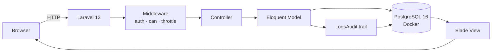
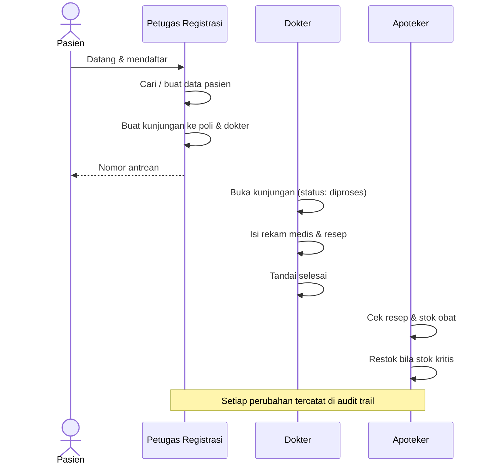
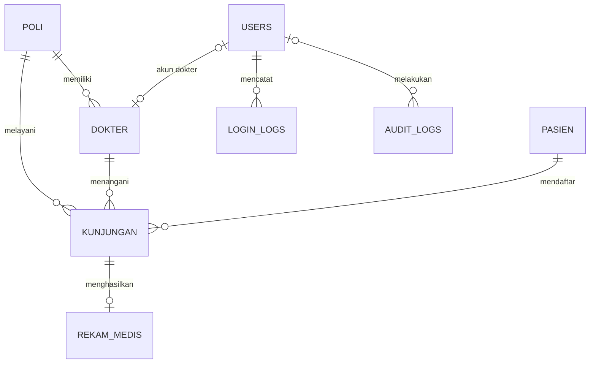

# Deskripsi Sistem — SIMRS dr. Tjahyo

Dokumen ini menjelaskan sistem secara menyeluruh: latar belakang, arsitektur,
teknologi, fitur, hak akses, keamanan, dan pengujian. Ditujukan untuk portofolio,
proposal, maupun dokumentasi teknis.

Versi bahasa Inggris: [SYSTEM-DESCRIPTION.md](SYSTEM-DESCRIPTION.md)

---

## 1. Ringkasan

**SIMRS dr. Tjahyo** adalah sistem informasi manajemen rumah sakit berbasis web
yang menangani alur inti layanan rawat jalan: pendaftaran pasien, pembuatan
kunjungan, pemeriksaan dan pengisian rekam medis oleh dokter, serta pemantauan
stok obat oleh apoteker.

Sistem ini dibangun dengan **Laravel 13**, **PostgreSQL 16**, dan **Bootstrap 5**,
menerapkan **kontrol akses berbasis peran (RBAC)** untuk empat peran pengguna,
serta **audit trail** yang mencatat setiap perubahan data beserta nilai lama dan
baru. Seluruh alur utama dilindungi **31 automated test**.

| Fakta | Nilai |
|---|---|
| Jenis aplikasi | Web (server-rendered) |
| Peran pengguna | 4 (Admin, Registrasi, Dokter, Apoteker) |
| Izin granular | 15 |
| Modul CRUD | 7 (poli, dokter, pasien, kunjungan, rekam medis, obat, pengguna) |
| Tabel database | 17 (9 domain + 8 infrastruktur) |
| Route terdaftar | 59 |
| Controller | 12 |
| Model Eloquent | 9 |
| Automated test | 31 tes, 123 assertion |
| Bahasa antarmuka | Indonesia |
| Zona waktu | Asia/Jakarta |

---

## 2. Latar belakang dan masalah

Rumah sakit kecil dan klinik sering masih mencatat pendaftaran pasien secara
manual atau memakai spreadsheet. Cara ini menimbulkan masalah:

1. **Data tidak konsisten** — pasien yang sama tercatat berkali-kali dengan
   ejaan berbeda.
2. **Stok obat tidak diketahui** — obat habis baru disadari saat dibutuhkan.
3. **Tidak ada jejak perubahan** — ketika data pasien berubah atau terhapus,
   tidak ada yang tahu siapa pelakunya dan kapan.
4. **Akses tidak terkontrol** — semua orang bisa membuka semua data, padahal
   data medis bersifat rahasia.

Sistem ini menjawab keempat masalah tersebut, dengan penekanan pada dua hal yang
sering dilewatkan proyek latihan: **otorisasi yang ditegakkan di server** dan
**ketertelusuran perubahan data**.

---

## 3. Tujuan dan ruang lingkup

**Tujuan**

- Menyediakan satu sumber data pasien, kunjungan, rekam medis, dan obat.
- Membatasi akses sesuai tugas masing-masing peran.
- Mencatat setiap perubahan data agar dapat diaudit.
- Menjadi fondasi yang bisa dikembangkan ke modul lanjutan (kasir, laboratorium,
  rawat inap, integrasi SATUSEHAT).

**Ruang lingkup saat ini**

- Layanan **rawat jalan** (poliklinik), bukan rawat inap.
- Satu rumah sakit, bukan multi-cabang.
- Data dummy untuk demonstrasi, belum data pasien nyata.

**Di luar ruang lingkup**

- Billing/kasir, laboratorium, radiologi, rawat inap.
- Cetak PDF dan integrasi HL7 FHIR.
- Aplikasi mobile.

---

## 4. Arsitektur dan teknologi

### 4.1 Pola arsitektur

Aplikasi memakai pola **MVC (Model–View–Controller)** yang menjadi standar
Laravel, dengan lapisan tambahan:

- **Middleware** untuk autentikasi (`auth`), otorisasi (`can:`), dan pembatasan
  percobaan login (`throttle`).
- **Trait `LogsAudit`** yang menempel pada model dan otomatis menulis audit trail
  pada event `created`, `updated`, dan `deleted`.
- **Enum** untuk peran, izin, dan status kunjungan, sehingga nilai yang salah
  langsung menjadi error saat pengembangan.



### 4.2 Teknologi

| Lapisan | Teknologi | Versi | Alasan dipilih |
|---|---|---|---|
| Bahasa | PHP | 8.3.6 | Versi stabil, didukung luas hosting Indonesia |
| Framework | Laravel | 13.40.0 | Ekosistem lengkap: ORM, migrasi, validasi, otorisasi |
| Database | PostgreSQL | 16.16 | Tipe `json` untuk audit, tipe data ketat, siap produksi |
| Kontainer | Docker + Compose | — | Versi database seragam di semua komputer |
| Tampilan | Blade + Bootstrap | 5.3.3 | Server-rendered, tanpa build step |
| Ikon | Bootstrap Icons | 1.11.3 | Ringan, cocok dengan Bootstrap |
| Font | Plus Jakarta Sans | — | Keterbacaan tinggi untuk teks panjang |
| Pengujian | PHPUnit | 12.5.43 | Standar Laravel, 31 tes |
| Gaya kode | Laravel Pint | 1.32.1 | Konsistensi format otomatis |
| Data palsu | FakerPHP | 1.24.1 | Seeder & factory dengan lokal Indonesia |

**Catatan penting:** aplikasi **tidak memakai Vite/Node** untuk aset frontend.
CSS dan JavaScript dimuat lewat CDN, sehingga tidak ada proses build dan aplikasi
bisa dijalankan hanya dengan PHP + Composer + Docker.

### 4.3 Struktur kode

```
app/
├── Enums/                  Role, Permission, StatusKunjungan
├── Http/Controllers/       12 controller (satu per modul)
├── Models/                 9 model Eloquent
│   └── Concerns/
│       └── LogsAudit.php   Pencatat audit trail
database/
├── migrations/             13 migrasi
├── seeders/                Data demo
└── factories/              Data uji
resources/views/            Blade: landing, dashboard, 7 modul, audit
tests/Feature/              30 tes alur HTTP
scripts/cek-rahasia.sh      Pemeriksa kebocoran kredensial
```

---

## 5. Modul dan fitur

### 5.1 Halaman publik

- Profil rumah sakit: layanan unggulan, jadwal dokter, informasi IGD 24 jam.
- Navigasi responsif (desktop dan ponsel).
- Tombol menuju halaman login pegawai.
- Tidak menampilkan data pasien apa pun.

### 5.2 Autentikasi dan keamanan login

- Login dengan email dan kata sandi.
- **Pembatasan 5 percobaan per 60 detik** per kombinasi email + IP.
- Akun nonaktif ditolak dengan pesan khusus.
- Setiap percobaan dicatat: berhasil/gagal, alasan, IP, dan perangkat.
- Setelah login berhasil: ID sesi diperbarui, waktu dan IP login terakhir disimpan.
- Logout menghapus sesi dan mengganti token CSRF.

### 5.3 Dashboard per peran

Setiap peran melihat dashboard berbeda, bukan hanya menu yang disembunyikan:

| Peran | Isi dashboard |
|---|---|
| Administrator | Statistik pasien, kunjungan hari ini, stok kritis, tautan audit trail |
| Petugas Registrasi | Antrean kunjungan hari ini, pasien terdaftar, akses cepat daftar baru |
| Dokter | Daftar kunjungan yang menunggu/diproses, rekam medis terbaru |
| Apoteker | Obat stok kritis, total item obat, resep terbaru |

### 5.4 Master data

**Poli** — nama dan deskripsi poliklinik. Hanya admin.

**Dokter** — nama, spesialisasi, nomor telepon, dan poli tempat bertugas.
Hanya admin. Akun dokter dapat ditautkan ke data dokter.

**Pasien** — nomor rekam medis otomatis berformat `RM-00001`, NIK 16 digit unik,
nama, jenis kelamin, tanggal lahir, alamat, dan nomor telepon. Dilengkapi:

- pencarian berdasarkan nama, nomor RM, atau NIK;
- pagination 10 baris;
- halaman detail berisi riwayat kunjungan pasien;
- validasi berbahasa Indonesia.

### 5.5 Kunjungan

- Pendaftaran pasien ke poli dan dokter pada tanggal tertentu.
- Nomor kunjungan dan keluhan awal.
- Alur status: **Menunggu → Diproses → Selesai**.
- Aksi "proses" oleh dokter/registrasi dan "selesai" oleh petugas.
- Filter dan pencarian daftar kunjungan.
- Halaman detail kunjungan menampilkan rekam medis terkait.

### 5.6 Rekam medis

- Satu rekam medis per kunjungan.
- Isi: diagnosa, tindakan, resep, dan catatan tambahan.
- Dibuat dan diubah oleh dokter; dapat dibaca oleh dokter dan apoteker.
- Setiap perubahan tercatat di audit trail.

### 5.7 Farmasi

- Daftar obat: nama, jenis, satuan, stok, stok minimum, dan harga.
- **Penanda stok kritis** ketika stok ≤ stok minimum.
- Aksi **restok** untuk menambah stok.
- Pencarian dan filter.
- Dikelola apoteker, dapat dilihat dokter.

### 5.8 Manajemen pengguna

- Membuat akun dengan nama, email, peran, dan status aktif.
- Mengubah peran dan menonaktifkan akun tanpa menghapus riwayat.
- Menautkan akun dokter ke data dokter.
- Kata sandi di-hash dengan bcrypt dan tidak pernah ditampilkan kembali.

### 5.9 Log login

- Riwayat percobaan login: email, status, alasan kegagalan, IP, perangkat, waktu.
- Berguna mendeteksi percobaan akses tidak sah.

### 5.10 Audit trail

Mencatat setiap **pembuatan, perubahan, dan penghapusan** data pada model:
pasien, kunjungan, rekam medis, obat, poli, dokter, dan pengguna.

Informasi yang disimpan:

| Kolom | Isi |
|---|---|
| `user_id`, `user_name`, `user_email`, `user_role` | Siapa pelakunya |
| `action` | `created`, `updated`, `deleted` |
| `auditable_type`, `auditable_id` | Data apa yang berubah |
| `label` | Label ramah manusia, mis. `Pasien: Budi Santoso` |
| `old_values` (JSON) | Nilai sebelum perubahan |
| `new_values` (JSON) | Nilai sesudah perubahan |
| `ip_address`, `user_agent` | Dari mana perubahan dilakukan |
| `created_at` | Kapan |

Fitur halaman audit trail:

- filter per aksi (dibuat/diubah/dihapus);
- filter per jenis data;
- pencarian nama pengguna, label data, atau IP;
- ringkasan hari ini: jumlah dibuat, diubah, dihapus;
- detail "nilai lama → nilai baru" per field.

**Yang sengaja tidak dicatat:**

- `password` dan `remember_token` — nilai rahasia tidak boleh masuk log;
- `last_login_at` dan `last_login_ip` — sudah ada di log login;
- perubahan dari seeder/`artisan tinker` — agar data demo tidak mengotori audit.

---

## 6. Peran dan hak akses

Sistem memakai **15 izin granular** yang dikelompokkan ke dalam 4 peran.

| Modul / Aksi | Admin | Registrasi | Dokter | Apoteker |
|---|:--:|:--:|:--:|:--:|
| Dashboard | ✅ | ✅ | ✅ | ✅ |
| Pasien — lihat | ✅ | ✅ | ✅ | — |
| Pasien — kelola | ✅ | ✅ | — | — |
| Kunjungan — lihat | ✅ | ✅ | ✅ | — |
| Kunjungan — kelola | ✅ | ✅ | — | — |
| Kunjungan — proses | ✅ | ✅ | ✅ | — |
| Rekam medis — lihat | ✅ | — | ✅ | ✅ |
| Rekam medis — kelola | ✅ | — | ✅ | — |
| Obat — lihat | ✅ | — | ✅ | ✅ |
| Obat — kelola | ✅ | — | — | ✅ |
| Poli | ✅ | — | — | — |
| Dokter | ✅ | — | — | — |
| Pengguna | ✅ | — | — | — |
| Log login | ✅ | — | — | — |
| Audit trail | ✅ | — | — | — |

Otorisasi diperiksa **di server** melalui middleware `can:`, bukan hanya dengan
menyembunyikan tombol di tampilan. Ada tes otomatis yang memastikan akses
terlarang menghasilkan **HTTP 403**.

---

## 7. Alur kerja



---

## 8. Struktur data

17 tabel: **9 tabel domain** dan **8 tabel infrastruktur** (migrasi, sesi, cache,
antrian, log login, audit, reset password, pengguna).

**Tabel domain**

| Tabel | Fungsi |
|---|---|
| `users` | Akun pegawai: nama, email, peran, status aktif, login terakhir |
| `poli` | Poliklinik |
| `dokter` | Data dokter dan polinya |
| `pasien` | Identitas pasien dan nomor rekam medis |
| `kunjungan` | Pendaftaran pasien ke poli/dokter + status |
| `rekam_medis` | Diagnosa, tindakan, resep, catatan |
| `obat` | Nama, jenis, satuan, stok, stok minimum, harga |
| `login_logs` | Riwayat percobaan login |
| `audit_logs` | Jejak perubahan data |



Relasi utama:

- satu **poli** memiliki banyak **dokter** dan banyak **kunjungan**;
- satu **pasien** memiliki banyak **kunjungan**;
- satu **kunjungan** memiliki paling banyak satu **rekam medis**;
- satu **user** dapat tertaut ke satu **dokter**.

---

## 9. Keamanan

| Aspek | Penerapan |
|---|---|
| Kata sandi | Hash bcrypt (12 rounds); tidak pernah ditampilkan atau dicatat |
| Login | Maksimal 5 percobaan/60 detik per email + IP |
| Akun nonaktif | Ditolak saat login, tercatat di log |
| Sesi | Disimpan di database, cookie `HttpOnly` + `SameSite=Lax`, ID diperbarui setelah login |
| CSRF | Token wajib pada setiap form POST/PUT/DELETE |
| Otorisasi | RBAC 15 izin, diperiksa di server via middleware |
| Audit | Perubahan data tercatat lengkap dengan nilai lama dan baru |
| Kredensial | `.env` tidak pernah masuk Git; `.gitignore` menutup `*.pem`, `*.key`, `*.sql`, dump |
| Seeder | Menolak berjalan saat `APP_ENV=production` |
| Pemeriksaan | `scripts/cek-rahasia.sh` memeriksa kebocoran kredensial sebelum push |
| Jaringan | Web dan database hanya mendengarkan `127.0.0.1` (tidak terbuka ke jaringan) |

**Rekomendasi sebelum produksi:** HTTPS, 2FA untuk admin, idle timeout,
rotasi kredensial, backup terenkripsi, dan uji restore.

---

## 10. Pengujian dan kualitas

```bash
php artisan test
# 31 tes, 123 assertion — lulus
```

| Berkas tes | Jumlah | Cakupan |
|---|:--:|---|
| `AuthenticationTest` | 8 | Login berhasil/gagal, pembatasan percobaan, akun nonaktif, logout |
| `AuthorizationTest` | 6 | Setiap peran hanya membuka modulnya, akses lain 403 |
| `AuditTrailTest` | 6 | Create/update/delete, nilai lama vs baru, password tidak tersimpan, admin-only |
| `PasienManagementTest` | 4 | Validasi NIK, nomor RM otomatis, pencarian, update |
| `PenggunaManagementTest` | 5 | Buat akun, ubah peran, nonaktifkan, validasi |
| `ExampleTest` | 2 | Halaman publik merespons 200 |

Tes berjalan di SQLite in-memory sehingga tidak menyentuh database development.

Kualitas kode dijaga dengan **Laravel Pint** (format otomatis) dan konvensi
Laravel: validasi di controller, logika data di model, tampilan di Blade.

---

## 11. Batasan saat ini

- Belum ada kasir/billing, laboratorium, radiologi, dan rawat inap.
- Belum ada cetak PDF (resep, kuitansi, surat keterangan).
- Belum terintegrasi SATUSEHAT/HL7 FHIR.
- Belum ada 2FA dan idle timeout.
- Belum ada backup otomatis terjadwal.
- Data demo masih sedikit.
- Belum ada CI (test masih dijalankan manual).

---

## 12. Rencana pengembangan

| Prioritas | Rencana |
|---|---|
| Tinggi | Dockerfile aplikasi + `docker compose up` untuk seluruh stack |
| Tinggi | CI GitHub Actions menjalankan tes di setiap push |
| Tinggi | Idle timeout dan 2FA untuk administrator |
| Sedang | Modul kasir dan cetak kuitansi PDF |
| Sedang | Grafik kunjungan dan pendapatan di dashboard |
| Sedang | Backup otomatis harian + uji restore |
| Rendah | Integrasi SATUSEHAT / HL7 FHIR |

---

## 13. Ringkasan untuk CV

**Satu kalimat**

> SIMRS dr. Tjahyo — sistem informasi rumah sakit berbasis Laravel 13 dan
> PostgreSQL dengan RBAC 4 peran, audit trail perubahan data, dan 31 automated test.

**Tiga poin**

- Membangun SIMRS fullstack (Laravel 13, PostgreSQL, Bootstrap) untuk alur rawat
  jalan: pasien, kunjungan, rekam medis, dan farmasi.
- Menerapkan RBAC 15 izin untuk 4 peran yang ditegakkan di server, plus audit
  trail yang mencatat nilai lama dan baru setiap perubahan data.
- Menulis 31 automated test (123 assertion) mencakup autentikasi, otorisasi,
  validasi, dan audit.

**Satu paragraf**

> Mengembangkan SIMRS berbasis web dari nol menggunakan Laravel 13, PostgreSQL 16,
> dan Bootstrap 5. Sistem menangani pendaftaran pasien, kunjungan poliklinik,
> rekam medis elektronik, dan manajemen stok obat. Menerapkan kontrol akses
> berbasis peran untuk empat peran pengguna yang diperiksa di sisi server,
> audit trail perubahan data dengan nilai lama dan baru, pembatasan percobaan
> login, serta 31 automated test. Database dijalankan di Docker dan kode
> didokumentasikan dengan README, diagram arsitektur, dan ERD.

---

## 14. Daftar istilah

| Istilah | Arti sederhana |
|---|---|
| **SIMRS** | Sistem Informasi Manajemen Rumah Sakit |
| **RBAC** | Hak akses ditentukan oleh peran, bukan per orang |
| **Middleware** | Lapisan pemeriksaan sebelum permintaan masuk ke halaman |
| **Audit trail** | Catatan siapa mengubah apa, kapan, dan dari mana |
| **Migration** | File yang mendefinisikan struktur tabel database |
| **Seeder** | Pengisi data contoh untuk demonstrasi |
| **Eloquent** | Bagian Laravel yang mengelola data tabel sebagai objek |
| **Blade** | Mesin template Laravel untuk membuat halaman HTML |
| **Docker** | Wadah untuk menjalankan aplikasi/database secara konsisten |
| **Automated test** | Program yang menguji aplikasi secara otomatis |
