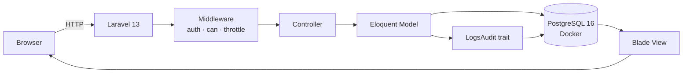
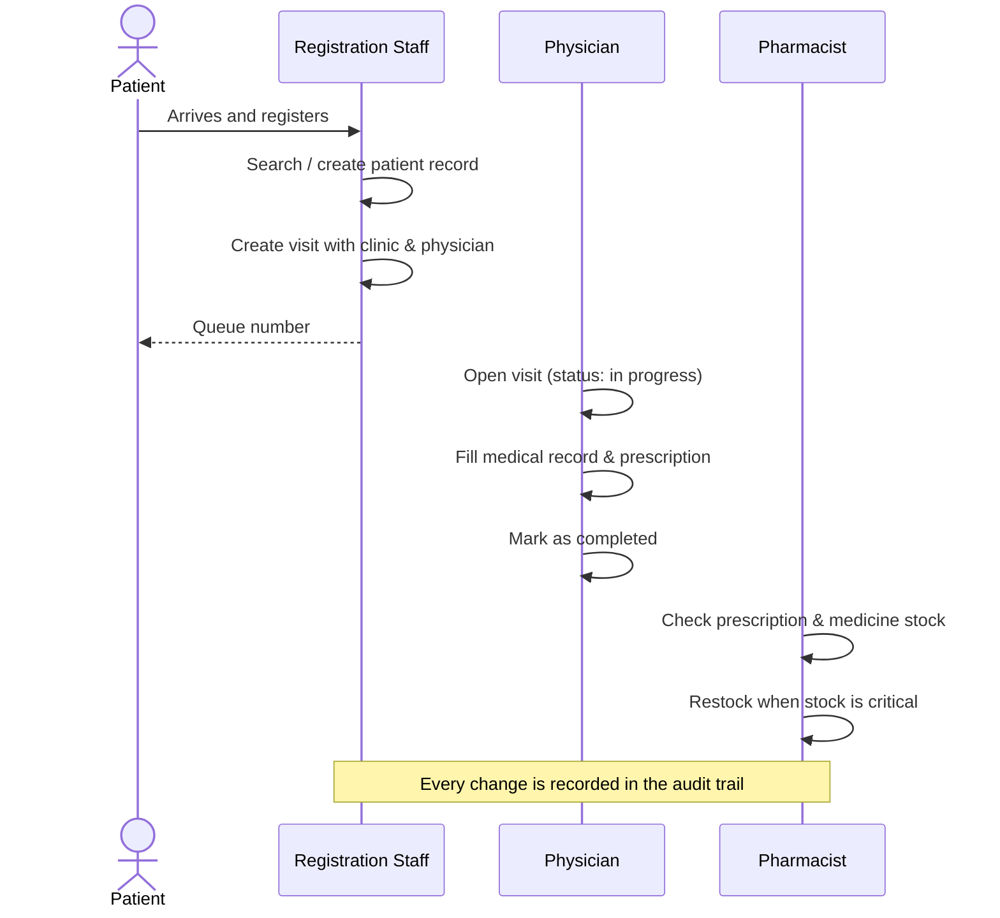
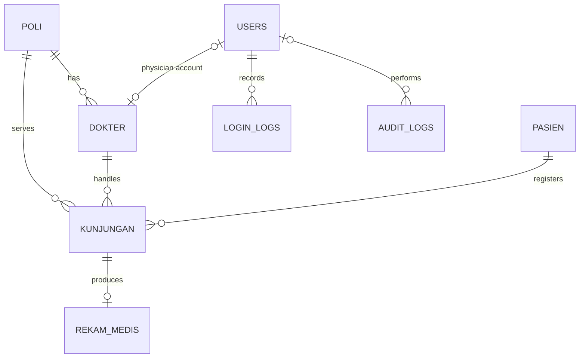

# System Description — SIMRS dr. Tjahyo

This document describes the system in detail: background, architecture,
technology stack, features, access control, security, and testing. It is intended
for a portfolio, a proposal, or technical documentation.

Indonesian version: [deskripsi-sistem.md](deskripsi-sistem.md)

---

## 1. Overview

**SIMRS dr. Tjahyo** is a web-based hospital management information system that
covers the core outpatient workflow: patient registration, visit creation,
examination and electronic medical records by physicians, and medicine stock
monitoring by pharmacists.

The system is built with **Laravel 13**, **PostgreSQL 16**, and **Bootstrap 5**.
It implements **role-based access control (RBAC)** for four user roles and an
**audit trail** that records every data change together with the old and new
values. The main flows are protected by **31 automated tests**.

| Fact | Value |
|---|---|
| Application type | Web (server-rendered) |
| User roles | 4 (Admin, Registration, Physician, Pharmacist) |
| Granular permissions | 15 |
| CRUD modules | 7 (clinics, physicians, patients, visits, medical records, medicines, users) |
| Database tables | 17 (9 domain + 8 infrastructure) |
| Registered routes | 59 |
| Controllers | 12 |
| Eloquent models | 9 |
| Automated tests | 31 tests, 123 assertions |
| Interface language | Indonesian |
| Time zone | Asia/Jakarta |

---

## 2. Background and problem

Small hospitals and clinics often record patient registration manually or in
spreadsheets. This creates four problems:

1. **Inconsistent data** — the same patient is recorded multiple times with
   different spellings.
2. **Unknown stock levels** — shortages are only discovered when a medicine is
   needed.
3. **No change history** — when patient data is modified or deleted, nobody knows
   who did it or when.
4. **Uncontrolled access** — everyone can open everything, even though medical
   data is confidential.

This system addresses all four, with emphasis on two things that practice
projects often skip: **server-side authorization** and **data traceability**.

---

## 3. Goals and scope

**Goals**

- Provide a single source of truth for patients, visits, medical records, and
  medicines.
- Restrict access according to each role's responsibilities.
- Record every data change so it can be audited.
- Serve as a foundation for further modules (billing, laboratory, inpatient care,
  SATUSEHAT integration).

**Current scope**

- **Outpatient** care (polyclinics), not inpatient care.
- Single hospital, not multi-branch.
- Dummy data for demonstration, not real patient data.

**Out of scope**

- Billing/cashier, laboratory, radiology, inpatient care.
- PDF printing and HL7 FHIR integration.
- Mobile applications.

---

## 4. Architecture and technology

### 4.1 Architectural pattern

The application follows the **MVC (Model–View–Controller)** pattern, the Laravel
standard, with additional layers:

- **Middleware** for authentication (`auth`), authorization (`can:`), and login
  attempt throttling (`throttle`).
- **`LogsAudit` trait** attached to models, automatically writing an audit entry
  on `created`, `updated`, and `deleted` events.
- **Enums** for roles, permissions, and visit status, so invalid values fail
  immediately during development instead of becoming silent production bugs.



### 4.2 Technology stack

| Layer | Technology | Version | Why it was chosen |
|---|---|---|---|
| Language | PHP | 8.3.6 | Stable, widely supported by Indonesian hosting |
| Framework | Laravel | 13.40.0 | Complete ecosystem: ORM, migrations, validation, authorization |
| Database | PostgreSQL | 16.16 | `json` support for audit data, strict typing, production-ready |
| Container | Docker + Compose | — | Consistent database version across machines |
| Front end | Blade + Bootstrap | 5.3.3 | Server-rendered, no build step |
| Icons | Bootstrap Icons | 1.11.3 | Lightweight and consistent with Bootstrap |
| Font | Plus Jakarta Sans | — | High legibility for long text |
| Testing | PHPUnit | 12.5.43 | Laravel standard, 31 tests |
| Code style | Laravel Pint | 1.32.1 | Automatic formatting consistency |
| Fake data | FakerPHP | 1.24.1 | Seeders and factories with Indonesian locale |

**Important note:** the application **does not use Vite/Node** for front-end
assets. CSS and JavaScript are loaded from a CDN, so there is no build step and
the app runs with only PHP, Composer, and Docker.

### 4.3 Code structure

```
app/
├── Enums/                  Role, Permission, StatusKunjungan
├── Http/Controllers/       12 controllers (one per module)
├── Models/                 9 Eloquent models
│   └── Concerns/
│       └── LogsAudit.php   Audit trail recorder
database/
├── migrations/             13 migrations
├── seeders/                Demo data
└── factories/              Test data
resources/views/            Blade: landing, dashboards, 7 modules, audit
tests/Feature/              30 HTTP flow tests
scripts/cek-rahasia.sh      Credential leak checker
```

---

## 5. Modules and features

### 5.1 Public page

- Hospital profile: services, physician schedules, and 24-hour emergency
  information.
- Responsive navigation (desktop and mobile).
- Link to the staff login page.
- Exposes no patient data whatsoever.

### 5.2 Authentication and login security

- Email and password login.
- **5 attempts per 60 seconds** per email + IP combination.
- Inactive accounts are rejected with a specific message.
- Every attempt is recorded: success/failure, reason, IP, and device.
- After a successful login: the session ID is regenerated, and the last login
  time and IP are stored.
- Logout invalidates the session and rotates the CSRF token.

### 5.3 Role-specific dashboards

Each role sees a different dashboard, not merely a filtered menu:

| Role | Dashboard content |
|---|---|
| Administrator | Patient statistics, today's visits, critical stock, audit trail link |
| Registration staff | Today's visit queue, registered patients, quick registration access |
| Physician | Visits waiting/in progress, recent medical records |
| Pharmacist | Critical stock items, total medicine items, recent prescriptions |

### 5.4 Master data

**Clinics (Poli)** — name and description. Admin only.

**Physicians** — name, specialization, phone number, and assigned clinic. Admin
only. Physician accounts can be linked to physician records.

**Patients** — automatically generated medical record number in the `RM-00001`
format, unique 16-digit national ID (NIK), name, gender, date of birth, address,
and phone number. Includes:

- search by name, medical record number, or national ID;
- pagination of 10 rows;
- a detail page with the patient's visit history;
- validation messages in Indonesian.

### 5.5 Visits

- Register a patient with a clinic and physician on a given date.
- Visit number and initial complaint.
- Status flow: **Waiting → In Progress → Completed**.
- "Process" action by physician/registration staff and "complete" by staff.
- Filtering and searching the visit list.
- Visit detail page showing the related medical record.

### 5.6 Medical records

- One medical record per visit.
- Contents: diagnosis, procedures, prescription, and additional notes.
- Created and edited by physicians; readable by physicians and pharmacists.
- Every change is recorded in the audit trail.

### 5.7 Pharmacy

- Medicine list: name, type, unit, stock, minimum stock, and price.
- **Critical stock indicator** when stock ≤ minimum stock.
- **Restock** action to increase stock.
- Search and filter.
- Managed by pharmacists, visible to physicians.

### 5.8 User management

- Create accounts with name, email, role, and active status.
- Change roles and deactivate accounts without deleting history.
- Link physician accounts to physician records.
- Passwords are hashed with bcrypt and never displayed again.

### 5.9 Login logs

- Login attempt history: email, status, failure reason, IP, device, and time.
- Useful for detecting unauthorized access attempts.

### 5.10 Audit trail

Records every **creation, update, and deletion** on the patient, visit, medical
record, medicine, clinic, physician, and user models.

Stored information:

| Column | Content |
|---|---|
| `user_id`, `user_name`, `user_email`, `user_role` | Who performed the change |
| `action` | `created`, `updated`, `deleted` |
| `auditable_type`, `auditable_id` | Which record changed |
| `label` | Human-readable label, e.g. `Pasien: Budi Santoso` |
| `old_values` (JSON) | Values before the change |
| `new_values` (JSON) | Values after the change |
| `ip_address`, `user_agent` | Where the change came from |
| `created_at` | When it happened |

Audit trail page features:

- filter by action (created/updated/deleted);
- filter by data type;
- search by user name, data label, or IP;
- today's summary: number created, updated, deleted;
- per-field "old value → new value" detail.

**Intentionally not recorded:**

- `password` and `remember_token` — secret values must never enter a log;
- `last_login_at` and `last_login_ip` — already covered by login logs;
- changes made by seeders/`artisan tinker` — to keep demo data out of the audit.

---

## 6. Roles and permissions

The system uses **15 granular permissions** grouped into 4 roles.

| Module / Action | Admin | Registration | Physician | Pharmacist |
|---|:--:|:--:|:--:|:--:|
| Dashboard | ✅ | ✅ | ✅ | ✅ |
| Patients — view | ✅ | ✅ | ✅ | — |
| Patients — manage | ✅ | ✅ | — | — |
| Visits — view | ✅ | ✅ | ✅ | — |
| Visits — manage | ✅ | ✅ | — | — |
| Visits — process | ✅ | ✅ | ✅ | — |
| Medical records — view | ✅ | — | ✅ | ✅ |
| Medical records — manage | ✅ | — | ✅ | — |
| Medicines — view | ✅ | — | ✅ | ✅ |
| Medicines — manage | ✅ | — | — | ✅ |
| Clinics | ✅ | — | — | — |
| Physicians | ✅ | — | — | — |
| Users | ✅ | — | — | — |
| Login logs | ✅ | — | — | — |
| Audit trail | ✅ | — | — | — |

Authorization is enforced **on the server** through `can:` middleware, not just by
hiding buttons in the interface. Automated tests verify that forbidden access
returns **HTTP 403**.

---

## 7. Workflow



---

## 8. Data model

17 tables: **9 domain tables** and **8 infrastructure tables** (migrations,
sessions, cache, queues, login logs, audit, password resets, users).

**Domain tables**

| Table | Purpose |
|---|---|
| `users` | Staff accounts: name, email, role, active status, last login |
| `poli` | Polyclinics |
| `dokter` | Physician records and their clinic |
| `pasien` | Patient identity and medical record number |
| `kunjungan` | Patient registration to a clinic/physician + status |
| `rekam_medis` | Diagnosis, procedures, prescription, notes |
| `obat` | Name, type, unit, stock, minimum stock, price |
| `login_logs` | Login attempt history |
| `audit_logs` | Data change history |



Key relationships:

- one **clinic** has many **physicians** and many **visits**;
- one **patient** has many **visits**;
- one **visit** has at most one **medical record**;
- one **user** may be linked to one **physician**.

---

## 9. Security

| Area | Implementation |
|---|---|
| Passwords | bcrypt hashing (12 rounds); never displayed or logged |
| Login | Maximum 5 attempts/60 seconds per email + IP |
| Inactive accounts | Rejected at login and recorded in the log |
| Sessions | Stored in the database, `HttpOnly` + `SameSite=Lax` cookies, ID regenerated after login |
| CSRF | Token required on every POST/PUT/DELETE form |
| Authorization | RBAC with 15 permissions, enforced server-side via middleware |
| Audit | Every data change recorded with old and new values |
| Credentials | `.env` never committed; `.gitignore` excludes `*.pem`, `*.key`, `*.sql`, dumps |
| Seeder | Refuses to run when `APP_ENV=production` |
| Checks | `scripts/cek-rahasia.sh` scans for credential leaks before pushing |
| Network | Web and database listen on `127.0.0.1` only (not exposed to the network) |

**Recommended before production:** HTTPS, 2FA for administrators, idle timeout,
credential rotation, encrypted backups, and restore drills.

---

## 10. Testing and quality

```bash
php artisan test
# 31 tests, 123 assertions — passing
```

| Test file | Count | Coverage |
|---|:--:|---|
| `AuthenticationTest` | 8 | Successful/failed login, attempt throttling, inactive accounts, logout |
| `AuthorizationTest` | 6 | Each role opens only its modules; other access returns 403 |
| `AuditTrailTest` | 6 | Create/update/delete, old vs new values, password excluded, admin-only page |
| `PasienManagementTest` | 4 | National ID validation, automatic record number, search, update |
| `PenggunaManagementTest` | 5 | Create accounts, change roles, deactivate, validation |
| `ExampleTest` | 2 | Public page responds with 200 |

Tests run on in-memory SQLite, so they never touch the development database.

Code quality is maintained with **Laravel Pint** (automatic formatting) and
Laravel conventions: validation in controllers, data logic in models, presentation
in Blade.

---

## 11. Current limitations

- No cashier/billing, laboratory, radiology, or inpatient modules.
- No PDF printing (prescriptions, receipts, medical certificates).
- No SATUSEHAT/HL7 FHIR integration.
- No 2FA or idle timeout yet.
- No scheduled automatic backups.
- Demo data set is still small.
- No CI yet (tests are run manually).

---

## 12. Roadmap

| Priority | Plan |
|---|---|
| High | Application Dockerfile + `docker compose up` for the whole stack |
| High | GitHub Actions CI running tests on every push |
| High | Idle timeout and 2FA for administrators |
| Medium | Cashier module and PDF receipts |
| Medium | Visit and revenue charts on the dashboard |
| Medium | Daily automatic backups + restore drills |
| Low | SATUSEHAT / HL7 FHIR integration |

---

## 13. CV-ready summary

**One sentence**

> SIMRS dr. Tjahyo — a hospital information system built with Laravel 13 and
> PostgreSQL, featuring RBAC for 4 roles, a data audit trail, and 31 automated tests.

**Three bullet points**

- Built a full-stack hospital information system (Laravel 13, PostgreSQL,
  Bootstrap) covering outpatient flow: patients, visits, medical records, and
  pharmacy.
- Implemented RBAC with 15 permissions across 4 roles enforced server-side, plus
  an audit trail capturing old and new values for every data change.
- Wrote 31 automated tests (123 assertions) covering authentication,
  authorization, validation, and auditing.

**One paragraph**

> Built a web-based hospital information system from scratch using Laravel 13,
> PostgreSQL 16, and Bootstrap 5. The system handles patient registration,
> outpatient visits, electronic medical records, and medicine stock management.
> It implements role-based access control for four roles enforced on the server,
> an audit trail recording old and new values for every data change, login attempt
> throttling, and 31 automated tests. The database runs in Docker, and the project
> is documented with a README, architecture diagram, and ERD.

---

## 14. Glossary

| Term | Plain meaning |
|---|---|
| **SIMRS** | Hospital Management Information System (Indonesian term) |
| **RBAC** | Access is determined by role, not by individual |
| **Middleware** | A check layer before a request reaches a page |
| **Audit trail** | A record of who changed what, when, and from where |
| **Migration** | A file that defines the database table structure |
| **Seeder** | A script that fills the database with sample data |
| **Eloquent** | Laravel's component for handling table data as objects |
| **Blade** | Laravel's template engine for generating HTML |
| **Docker** | A container that runs an app/database consistently |
| **Automated test** | A program that tests the application automatically |
